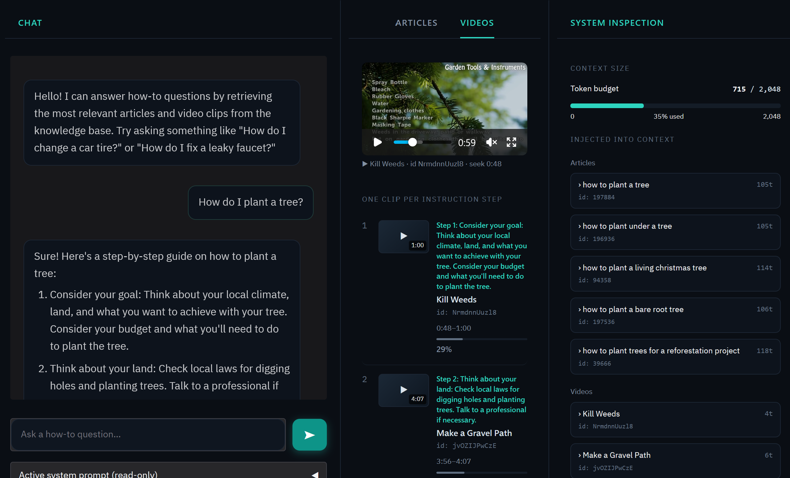
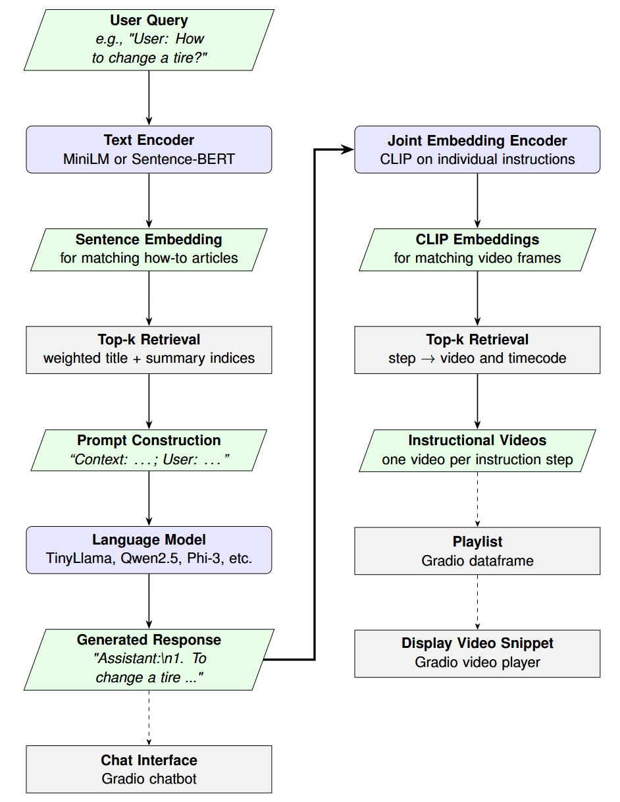

# How-To RAG Assistant

A Gradio chat app that answers how-to questions in numbered steps. In full mode, it retrieves WikiHow articles to ground its answer and looks up a HowTo100M video segment for each step.

Fig 1: Interface example after a prompt. Left: Interactive chat window where the user prompts the LLM. Middle: Articles and videos tab show retrieved data along with how well they match the query and allow for playback of individual videos clips. Right: System data like token budget, unique retrieved articles and videos, and retrieval settings + latency (not visible in this screenshot).

Fig 2: End-to-end system pipeline. User queries are encoded for article retrieval and prompt construction, followed by text generation. Generated instructions are further encoded with a joint embedding model (CLIP) to retrieve and display aligned intructional video segments. 

## Start the app

Clone the repository (make sure Git LFS is installed) or download it as a zip file. Install the requirements and run python app.py in the respective folder.

Open [http://127.0.0.1:7860](http://127.0.0.1:7860) or use the address printed in the terminal. Try "How do I plant a tree?" and open the Articles and Videos tabs to see the retrieval results. Press `Ctrl+C` to stop the app.

On launch, the app downloads `all-MiniLM-L6-v2`, `CLIP ViT-B/32`, and `TinyLlama/TinyLlama-1.1B-Chat-v1.0` from Hugging Face. Please note that the used LLM is prone to hallucination and may not work well on every prompt. Additionally, depending on your device, responses may take long (~30s). Hardware restrictions of running a local model constrain performance.

## Project structure

| Path | Purpose |
| --- | --- |
| `app.py` | Gradio entry point with chat, article and video panels, and system inspection. |
| `rag_backend.py` | Loads the notebook definitions, connects the models and indexes, and provides the demo backend. |
| `01_Preprocessing.ipynb` | Builds the WikiHow SQLite database, article and video FAISS indexes, and video clip metadata. |
| `02_Chatbot_Setup.ipynb` | Defines the chat model setup and prompt token budget. |
| `03_RAG.ipynb` | Defines retrieval, prompt assembly, answer generation, and step-to-video matching. |
| `Interface_Mockup/` | Original [article panel](Interface_Mockup/UI_Mockup1.png) and [video panel](Interface_Mockup/UI_Mockup2.png) designs. |
| `requirements.txt` | Dependencies for the Gradio interface, retrieval, and local model inference. |
| `Data/` | Prepared database, indexes, and clip metadata for the full app. |

## Data folder

| Path | Contents |
| --- | --- |
| `Data/wikihow.db` | SQLite database with the `wikihow_articles` table. |
| `Data/Embeddings/title_index.faiss` | Article title index. |
| `Data/Embeddings/combined_index.faiss` | Article title and summary index. |
| `Data/Embeddings/clip_index.faiss` | Video clip index. |
| `Data/HowTo100M/clip_metadata.csv` | Video IDs, timestamps, and metadata in index order. |
| `Data/HowTo100M/videos/<video_id>.mp4` | Video files for in-app playback. Clip matches and timestamps are available without the MP4s. |

The app starts in demo mode when the data folder and runtime files are absent. If the data folder is incomplete, a Git LFS file was skipped, or a model fails to load, startup reports the problem in the terminal.

### Optional video download

Videos are too large for github, but can be downloaded [here](https://1drv.ms/f/c/20e43b6fa1a24152/IgB8AVHmAq7wTIOS11GGCWMEAdZLpZUyxcd4xU4JvbcYQYI?e=iyJQhs).
Copy them into `Data/HowTo100M/videos/`. The app picks up the files automatically when you select a clip. Video retrieval and timestamps work with the bundled index and metadata.

If videos are not downloaded, the interface will still show matching videos (found by index), but playback will not work.

Dataset sources are the [WikiHow dataset paper](https://arxiv.org/abs/1810.09305) and the [HowTo100M project](https://www.di.ens.fr/willow/research/howto100m/).
